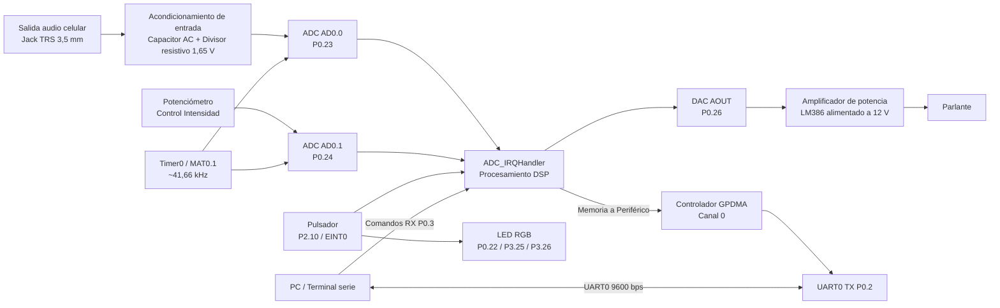

# EFFECMASTER9600 — Pedal multiefectos digital con LPC1769

> **Asignatura:** Electrónica Digital III — Universidad Nacional de Córdoba  
> **Integrantes:** Gomez Alzuarena, Sebastian · Quintero, Jonathan Damian  
> **Profesor:** Blasco, Marcos Javier
> **Plataforma:** NXP LPC1769 (ARM Cortex-M3)  
> **Estado:**

---

## 🚀 1. Descripción General del Proyecto

**EFFECMASTER9600** es un procesador de audio digital en tiempo real, desarrollado con el microcontrolador **NXP LPC1769**, orientado a funcionar como prototipo de pedal multiefectos fuentes de audio analógico acondicionado. La señal se adquiere por el ADC , se procesa por software y se reproduce por el DAC. El proyecto permite explorar técnicas de procesamiento digital de señales mediante periféricos integrados, sin recurrir a un procesador DSP externo. 

El usuario puede recorrer **seis modos** con un pulsador externo, un LED RGB indica el estado y un potenciómetro permite regular en tiempo real el parámetro de intensidad. Además, una interfaz serie UART0 a 9600 baudios permite consultar y modificar parámetros del procesamiento desde una terminal de computadora, utilizando GPDMA para transmitir los mensajes de estado y cambios de efecto sin interrumpir el procesamiento de audio.

### 🎯 Alcances del Proyecto
**El sistema es capaz de:**

- Adquirir audio desde **AD0.0 (P0.23)** y leer el nivel de intensidad mediante un potenciómetro conectado en **AD0.1 (P0.24)** con conversiones disparadas por **Timer0/MAT0.1**.
- Procesar las muestras y escribir la salida al **DAC de 10 bits (AOUT, P0.26)**.
- Seleccionar seis modos mediante un pulsador en **P2.10 (EINT0)**:

  | Modo | Implementación en el código |
  |---|---|
  | **Normal** | Envío de la muestra al DAC sin modificación digital intencional. |
  | **Distorsión** | Curva no lineal de saturación suave, regulada por `INTENSIDAD`. |
  | **Fuzz** | Recorte de amplitud en límites definidos a partir de `INTENSIDAD`. |
  | **Bitcrush** | Reducción de resolución efectiva mediante desplazamientos de bits (`CRUSH`). |
  | **Delay** | Eco con buffer circular, mezcla de señal actual y retardada, y realimentación. |
  | **Whammy** | Modificación de tono aproximada mediante lectura de buffer con interpolación y mezcla de dos ventanas. |

- Mostrar seis estados de LED RGB usando **P0.22, P3.25 y P3.26**.
- Recibir comandos de texto por UART0 y transmitir mensajes de estado y cambio de efecto a la consola mediante GPDMA (Memoria a Periférico).
  
**El sistema NO incluye en esta versión del código:**

- Almacenamiento persistente, Bluetooth, Wi-Fi, pantalla gráfica o interfaz móvil.
- Un sistema operativo en tiempo real (RTOS).
- Transferencia por DMA para el flujo de muestras de audio (ADC/DAC)


### ⏩ Posibles Etapas Siguientes

- Incorporar **DMA en una tarea compatible con el audio**, sin alterar la sincronización del muestreo ni introducir discontinuidades en la señal.
- Agregar un **bypass físico**, controles dedicados y almacenamiento de presets.
- Medir latencia, distorsión, relación señal/ruido y consumo para optimizar el diseño.

---

## 📐 2. Arquitectura del Sistema: Hardware y Software

### 🔌 Hardware e Interconexión

**Diagrama de bloques funcional:**





**Descripción de las etapas analógicas (Entrada y Salida):**

El firmware trabaja con muestras digitales sin signo de 10 bits (`0` a `1023`), tomando el valor **`512` (~1,65 V)** como referencia de cero o reposo de la señal de audio. Dado que la salida de auriculares de un celular entrega una señal alterna (AC) centrada en `0 V` y de baja amplitud, y que el DAC del LPC1769 no posee corriente suficiente para excitar un parlante, se implementaron dos etapas analógicas externas:

1. **Etapa de acondicionamiento pasivo de entrada (Jack celular → Divisor resistivo → AD0.0 / P0.23):**
   - La señal proveniente del jack de audio ingresa a través de un capacitor de bloqueo de continua (desacople AC) hacia un **divisor resistivo** conectado entre **3,3 V** y **GND**.
   - De este modo, la señal alterna del celular queda montada sobre un nivel continuo (*DC Offset*) de **1,65 V** (valor digital `512`), evitando excursiones negativas y manteniéndola dentro del rango eléctrico seguro del ADC del LPC1769 (**0 V a 3,3 V**).
   
2. **Etapa de potencia de salida (DAC AOUT / P0.26 → LM386 → Parlante):**
   - La salida analógica del DAC (`P0.26`) se deriva mediante una resistencia de referencia a masa y un capacitor de acoplamiento que elimina la componente continua de `1,65 V`, entregando la señal de audio pura a la entrada del amplificador integrado **LM386**.
   - El **LM386** se alimenta con la fuente externa de **12 V DC** (compartiendo masa común **GND** con la placa LPC1769) y excita directamente el parlante de salida.
**Asignación de periféricos y señales:**

| Función | Recurso LPC1769 | Señal / configuración |
|---|---|---|
| Entrada de audio | ADC canal 0 | **P0.23 / AD0.0** (señal centrada en 1,65 V mediante divisor resistivo)|
| Potenciometro (Intensidad) | ADC canal 1 | **P0.4 / AD0.1** (cursor entre 0 V y 3,3 V) |
| Salida de audio | DAC | **P0.26 / AOUT** |
| Base de muestreo | Timer0 Match 1 | **MAT0.1** (disparo interno del ADC) |
| Cambio de efecto | Interrupción externa EINT0 | **P2.10**, flanco descendente, pull-up interno |
| LED rojo | GPIO | **P0.22**, activo en nivel bajo |
| LED verde | GPIO | **P3.25**, activo en nivel bajo |
| LED azul | GPIO | **P3.26**, activo en nivel bajo |
| Comunicación serie | UART0 TX + GPDMA | **P0.2**(envío de mensajes de efecto por DMA) |
| Comunicación serie | UART0 RX | **P0.3**(recepción por interrupción) |


**Consideraciones de diseño:** La adquisición de ambos canales del ADC (audio en AD0.0 y potenciómetro en AD0.1) se dispara desde Timer0 para mantener una cadencia periódica. El ADC entrega datos que el firmware desplaza dos posiciones a la derecha antes de procesarlos como muestras de 10 bits. El DAC se actualiza por software al finalizar el procesamiento de cada muestra. Para evitar que la transmisión lenta por UART0 (9600 bps) bloquee la CPU o genere latencia en el audio al cambiar de efecto, el envío de cadenas de texto hacia la consola se delega al controlador GPDMA. Los buffers de efectos se almacenan en RAM: bufferDelay[10000] (20 000 bytes) y bufferWhammy[1024] (2048 bytes).

### 💻 Arquitectura de Software (Firmware)

```mermaid
flowchart TD
    %% DEFINICIÓN DE ESTILOS POR COLOR
    classDef mainBox fill:#0f172a,stroke:#38bdf8,stroke-width:1.5px,color:#f8fafc
    classDef mainDec fill:#1e293b,stroke:#0284c7,stroke-width:2px,color:#bae6fd

    classDef adcBox fill:#1e1b4b,stroke:#818cf8,stroke-width:1.5px,color:#eef2ff
    classDef adcDec fill:#312e81,stroke:#6366f1,stroke-width:2px,color:#c7d2fe

    classDef eintBox fill:#4c0519,stroke:#fb7185,stroke-width:1.5px,color:#ffe4e6

    classDef dmaBox fill:#022c22,stroke:#34d399,stroke-width:1.5px,color:#ecfdf5
    classDef dmaDec fill:#064e3b,stroke:#10b981,stroke-width:2px,color:#a7f3d0

    classDef uartBox fill:#451a03,stroke:#fbbf24,stroke-width:1.5px,color:#fef3c7
    classDef uartDec fill:#78350f,stroke:#f59e0b,stroke-width:2px,color:#fde68a

    subgraph MAIN ["Programa Principal (main)"]
        direction TB
        Start(["Inicio / Reset LPC1769"]):::mainBox --> InitPerif["Inicializar Botón/LED, ADC CH0/CH1,<br/>DAC, Timer0, GPDMA y UART0"]:::mainBox
        InitPerif --> SetPrio["Configurar prioridades NVIC:<br/>EINT0(0), UART0(1), DMA(2), ADC(4)"]:::mainBox
        SetPrio --> InitBuf["Llenar bufferDelay[10000] con 512"]:::mainBox
        InitBuf --> Bienvenida["Enviar menú inicial por enviarUART_DMA()<br/>esperando uartDMABusy == 0"]:::mainBox
        Bienvenida --> StartT0["Habilitar Timer0 y encender LED Rojo"]:::mainBox
        StartT0 --> Loop{"Bucle while(1)"}:::mainDec
        Loop --> CheckBtn{"¿botonPendiente == 1?"}:::mainDec
        CheckBtn -->|Sí| ClearBtn["botonPendiente = 0<br/>NVIC_ClearPendingIRQ(EINT0)"]:::mainBox
        CheckBtn -->|No| Loop
        ClearBtn --> Loop
    end

    subgraph ADC_ISR ["ADC_IRQHandler (Prioridad 4 - ~41,66 kHz)"]
        direction TB
        T0_Trig(["Disparo MAT0.1"]):::adcBox --> IncPot["contadorPot++"]:::adcBox
        IncPot --> CheckPot{"¿contadorPot >= 4000?"}:::adcDec
        CheckPot -->|Sí| ReadPot["contadorPot = 0<br/>INTENSIDAD = (AD0.1 * 100) / 4095"]:::adcBox
        CheckPot -->|No| ReadAudio["muestra = AD0.0 >> 2"]:::adcBox
        ReadPot --> ReadAudio
        ReadAudio --> SwitchFx{"switch (EFECTO)"}:::adcDec
        SwitchFx -->|0: Normal| Fx0["Salida = muestra"]:::adcBox
        SwitchFx -->|1: Distorsión| Fx1["Saturación no lineal según INTENSIDAD"]:::adcBox
        SwitchFx -->|2: Fuzz| Fx2["Recorte en límites 4*INTENSIDAD"]:::adcBox
        SwitchFx -->|3: Bitcrush| Fx3["Desplazamiento (muestra >> CRUSH) << CRUSH"]:::adcBox
        SwitchFx -->|4: Delay| Fx4["bufferDelay con ECO1 y realimentación ECO2"]:::adcBox
        SwitchFx -->|5: Whammy| Fx5["bufferWhammy con interpolación y 2 ventanas"]:::adcBox
        Fx0 --> WriteDAC["DAC_UpdateValue(salida)"]:::adcBox
        Fx1 --> WriteDAC
        Fx2 --> WriteDAC
        Fx3 --> WriteDAC
        Fx4 --> WriteDAC
        Fx5 --> WriteDAC
        WriteDAC --> EndADC(["Fin ADC_IRQHandler"]):::adcBox
    end

    subgraph EINT_ISR ["EINT0_IRQHandler (Prioridad 0)"]
        direction TB
        BtnPress(["Flanco descendente P2.10"]):::eintBox --> NextFx["CambiarEfecto(): EFECTO = (EFECTO + 1) % 6<br/>botonPendiente = 1"]:::eintBox
        NextFx --> SetLED["Actualizar LED RGB (P0.22, P3.25, P3.26)"]:::eintBox
        SetLED --> SendDMA["enviarUART_DMA(nombre_efecto)<br/>Configura canal 0 GPDMA -> UART0 THR"]:::eintBox
        SendDMA --> ClearEINT["Limpiar flag EXTINT0"]:::eintBox
        ClearEINT --> EndEINT(["Fin EINT0_IRQHandler"]):::eintBox
    end

    subgraph DMA_ISR ["DMA_IRQHandler (Prioridad 2)"]
        direction TB
        DmaInt(["Interrupción GPDMA"]):::dmaBox --> DmaCheck{"¿Error o Terminal Count?"}:::dmaDec
        DmaCheck -->|Error| DmaErr["Limpiar error, deshabilitar CH0<br/>dmaErrores++, uartDMABusy = 0"]:::dmaBox
        DmaCheck -->|TC Fin| DmaOk["Limpiar TC, dmaCompletadas++<br/>uartDMABusy = 0"]:::dmaBox
        DmaErr --> EndDMA(["Fin DMA_IRQHandler"]):::dmaBox
        DmaOk --> EndDMA
    end

    subgraph UART_ISR ["UART0_IRQHandler (Prioridad 1)"]
        direction TB
        UartRx(["Dato en UART0 RX (P0.3)"]):::uartBox --> IsEnter{"¿Carácter es CR o LF?"}:::uartDec
        IsEnter -->|No| SaveChar["Guardar en comando[]"]:::uartBox
        IsEnter -->|Sí| ParseCmd["procesarComando():<br/>Valida S, I, D o A"]:::uartBox
        SaveChar --> UpdDeriv["Actualizar RETARDO, CRUSH, ECO1 y ECO2"]:::uartBox
        ParseCmd --> UpdDeriv
        UpdDeriv --> EndUART(["Fin UART0_IRQHandler"]):::uartBox
    end

    %% COLORES DE LOS CONTENEDORES (SUBGRAPHS)
    style MAIN fill:#082f49,stroke:#38bdf8,stroke-width:2px,color:#e0f2fe
    style ADC_ISR fill:#1e1b4b,stroke:#818cf8,stroke-width:2px,color:#e0e7ff
    style EINT_ISR fill:#3f0d1e,stroke:#fb7185,stroke-width:2px,color:#ffe4e6
    style DMA_ISR fill:#064e3b,stroke:#34d399,stroke-width:2px,color:#d1fae5
    style UART_ISR fill:#451a03,stroke:#fbbf24,stroke-width:2px,color:#fef3c7
```



**Funcionamiento resumido:**

 1. `main()` inicializa GPIO/LED RGB, EINT0, ADC (`CH0` y `CH1`), DAC, Timer0, GPDMA y UART0, asigna prioridades NVIC (`EINT0 = 0`, `UART0 = 1`, `DMA = 2`, `ADC = 4`), precarga `bufferDelay` en `512` y envía el menú de bienvenida por `enviarUART_DMA()`.
2. `Timer0` con prescaler de 1 microsegundo y `matchValue = 12` en modo *toggle* genera flancos ascendentes en **MAT0.1** cada 24 microsegundo (**~41,66 kHz** nominales), disparando la conversión del ADC.
3. En `ADC_IRQHandler()` se lee `AD0.0` (audio) y, cada 4000 muestras, se actualiza `INTENSIDAD` leyendo `AD0.1` (potenciómetro). Luego se aplica el algoritmo activo en `switch(EFECTO)` y se escribe el resultado en el DAC.
4. Al presionar el pulsador (`EINT0_IRQHandler`), avanza circularmente `EFECTO`, se actualiza el color del LED RGB y se dispara `enviarUART_DMA()` para transferir el nombre del efecto desde `bufferUART_DMA` hacia `LPC_UART0->THR`. Al finalizar la transferencia, `DMA_IRQHandler` libera la bandera `uartDMABusy`.
5. `UART0_IRQHandler` recibe comandos ASCII terminados en `\r` o `\n`, los valida en `procesarComando()` y recalcula los parámetros internos (`RETARDO`, `CRUSH`, `ECO1` y `ECO2`).

**Protocolo UART0** (9600 bps, 8 bits de datos, sin paridad, 1 bit de parada: **8N1**):

| Comando | Acción | Rango aceptado |
|---|---|---|
| `I50` |Ajustar INTENSIDAD a 50 (si no es sobreescrito por el potenciómetro)| 0 a 100 |
| `D100` | Ajustar `DELAY` a 100 | 0 a 200 |
| `A50` | Ajustar `ATENUACION` a 50 | 0 a 100 |
| `S` | Mostrar parámetros actuales | Sin valor |

Los comandos usan **letras mayúsculas** y se finalizan con retorno de carro o salto de línea. El firmware devuelve confirmaciones y mensajes para comandos o valores inválidos. En el código, `DELAY`, `ATENUACION` e `INTENSIDAD` se convierten además en parámetros internos (`RETARDO`, `ECO1`, `ECO2`, `CRUSH`) dentro de `UART0_IRQHandler()`.

**Buffers y parámetros principales:**

| Elemento | Valor en firmware | Función |
|---|---|---|
| `TAM_DELAY` | 10 000 muestras | Longitud del buffer circular de eco |
| `RETARDO` inicial | 4000 muestras | Equivalente nominal a 100 ms a 40 kHz |
| `ECO1` inicial | 50 % | Cantidad de señal retardada mezclada con la actual |
| `ECO2` inicial | 35 % | Realimentación del delay |
| `TAM_WHAMMY` | 1024 muestras | Buffer circular para modificación de tono |
| `VENTANA` | 512 muestras | Ventana de lectura del whammy |
| `RETARDO_MIN` | 32 muestras | Separación mínima usada para la lectura del whammy |
| `TAM_UART_DMA` | 128 bytes | Buffer de transmisión en RAM para el canal 0 de GPDMA |

> **Observaciones técnicas del código fuente:** (1) dado que `ADC_IRQHandler` actualiza `INTENSIDAD` desde el potenciómetro (`AD0.1`) cada 4000 muestras (~0,1 s), cualquier valor enviado por consola mediante el comando `Ixx` será sobreescrito por la posición física del potenciómetro en la siguiente lectura; (2) en `UART0_IRQHandler`, los rangos intermedios de `CRUSH` contienen condiciones mutuamente excluyentes (por ejemplo, `INTENSIDAD < 20 && INTENSIDAD <= 40` evaluado después de `INTENSIDAD <= 20`), por lo que conviene reemplazarlas por `INTENSIDAD <= 40`, `INTENSIDAD <= 60`, etc.
---

## ⚡ 3. Especificaciones Eléctricas, Alimentación y Entorno

### 🔌 Parámetros de Alimentación y Consumo

| Parámetro | Información disponible |
|---|---|
| Tensión lógica del LPC1769 | **3,3 V nominales**, sujetos a las especificaciones de la placa |
| Tensión de referencia ADC / Divisor / Potenciómetro | **3,3 V** (VREF / VDDA) |
| Método de alimentación (MICROCONTROLADOR) | **Puerto USB (5 V)** conectado a la placa de desarrollo LPC1769 |
|Fuente de señal de entrada | Salida de audio analógico (**Jack 3,5 mm**) |
| Alimentación de etapa de salida (LM386) | **Fuente externa de 12 V DC**(con masa común respecto al GND de la LPC1769) |
| Condiciones de ensayo | Alimentación USB + fuente 12 V en etapa LM386 [**Oscilosopio**] |

### 🧠 Especificaciones de Electrónica Digital III (Cortex-M / ARM)

- **IDE:** MCUXpresso IDE (completar versión instalada: `[versión]`).
- **Microcontrolador:** NXP LPC1769, arquitectura **ARM Cortex-M3** operando a **CCLK = 100 MHz**.
- **Bibliotecas utilizadas:** CMSIS/LPC17xx y drivers `lpc17xx_adc.h`, `lpc17xx_dac.h`, `lpc17xx_gpdma.h`, `lpc17xx_timer.h`, `lpc17xx_uart.h`.
- **Periféricos utilizados efectivamente:** ADC (canales **AD0.0** y **AD0.1**), DAC, Timer0 (`MAT0.1`), UART0, **GPDMA** (canal 0), GPIO, EINT0 y NVIC.
- **Uso de DMA:** Implementado mediante **GPDMA (Memoria a Periférico)** vinculado a la solicitud `8` (`UART0 TX`), transfiriendo desde `bufferUART_DMA` hacia `LPC_UART0->THR` sin bloquear el procesamiento de audio.
- **Frecuencia de muestreo nominal:** **~41,66 kHz** (`Timer0` con prescaler de $1\,\mu\text{s}$ y `matchValue = 12` en modo *toggle*).
- **Resolución de procesamiento/salida:** **10 bits** (muestra ADC de 12 bits desplazada 2 bits a la derecha y salida DAC de 10 bits).
- **Estrategia de concurrencia:** **bare-metal** dirigido por interrupciones jerarquizadas mediante NVIC (`EINT0` prioridad 0, `UART0` prioridad 1, `DMA` prioridad 2, `ADC` prioridad 4).
---

## 🔄 4. Proceso de Integración y Desarrollo

*La siguiente secuencia organiza los módulos presentes en el firmware.*

**Etapa 1 — Puesta en marcha de la placa y controles:** configuración de los GPIO del LED RGB, el botón EINT0 y el NVIC. Comprobación del cambio circular entre los seis efectos por pulsador.

**Etapa 2 — Adquisición multicanal y reproducción:** inicialización del ADC en AD0.0 (P0.23) para audio y AD0.1 (P0.24) para el potenciómetro, el DAC y Timer0/MAT0.1. Validación del modo Normal y lectura analógica del potenciómetro.

**Etapa 3 — Integración de efectos:** implementación de distorsión, fuzz y bitcrush regulados por la lectura del potenciómetro (INTENSIDAD); incorporación de buffers circulares para delay y whammy.

**Etapa 4 — Comunicación UART0 y GPDMA:** inicialización de UART0 a 9600 baudios, recepción de comandos por interrupción y configuración del controlador GPDMA para transmitir hacia la consola el mensaje del efecto activo al presionar el pulsador.

**Etapa 5 — Integración y verificación final:** verificar simultáneamente la estabilidad del audio, la respuesta del potenciómetro, los cambios de modo, el envío por GPDMA hacia la terminal y el comportamiento del LED RGB.

---

## 📊 5. Ensayo, pruebas y resultados.

**CIRCUITO ARMADO** 


**EFECTOS**


**SIN EFECTOS**


**DISTORSION**


**FUZZ**


**BIT CRUNCH**


**DELAY**


**WHAMMY**


### VIDEOS
**PRUEBAS**

https://github.com/Electronica-Digital-3-UNC/TPFDIG3-c2-g16/blob/main/Proyecto/inicio.mp4
https://github.com/Electronica-Digital-3-UNC/TPFDIG3-c2-g16/blob/main/Proyecto/efectos.mp4
https://github.com/Electronica-Digital-3-UNC/TPFDIG3-c2-g16/blob/main/Proyecto/efectos2.mp4


**FUNCIONAMIENTO**

https://github.com/Electronica-Digital-3-UNC/TPFDIG3-c2-g16/blob/main/Proyecto/funcionamiento.mp4

## 📂 6. Estructura del Repositorio

```text
EFFECMASTER9600/
├── Proyecto/
│   |  │── main.c                  # Firmware principal: ADC, DAC, Timer, UART y efectos
|   ├── efectos.mp4
│   ├── efectos2.mp4
│   ├── funcionamiento.mp4
│   └── inicio.mp4
└── README.md
```


